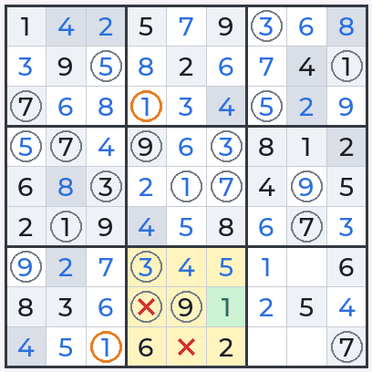

<!-- Written by tools/walkthrough.py even-odd: edit the script, not this page. -->
# Even-Odd, step 46: the 1 in box 8

**Step 46 of 51** · [← Step 45](step-45.md) · [All steps](../even-odd.md#the-whole-puzzle-step-by-step) · [Step 47 →](step-47.md)

Box 8 needs a 1. r8c4: column 4 has one (r3c4). r9c5: row 9 has one (r9c3). Only **r8c6** is left: **r8c6 = 1**.

**Step 46 of 51** · [← Step 45](step-45.md) · [All steps](../even-odd.md#the-whole-puzzle-step-by-step) · [Step 47 →](step-47.md)
