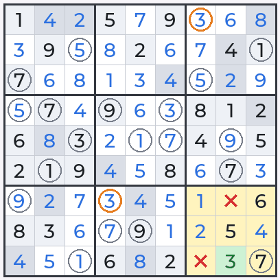

<!-- Written by tools/walkthrough.py even-odd: edit the script, not this page. -->
# Even-Odd, step 49: the 3 in box 9

**Step 49 of 51** · [← Step 48](step-48.md) · [All steps](../even-odd.md#the-whole-puzzle-step-by-step) · [Step 50 →](step-50.md)

Box 9 needs a 3. r7c8: row 7 has one (r7c4). r9c7: column 7 has one (r1c7). Only **r9c8** is left: **r9c8 = 3**.

**Step 49 of 51** · [← Step 48](step-48.md) · [All steps](../even-odd.md#the-whole-puzzle-step-by-step) · [Step 50 →](step-50.md)
