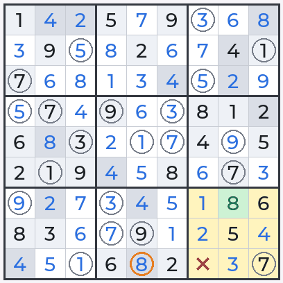

<!-- Written by tools/walkthrough.py even-odd: edit the script, not this page. -->
# Even-Odd, step 50: the 8 in box 9

**Step 50 of 51** · [← Step 49](step-49.md) · [All steps](../even-odd.md#the-whole-puzzle-step-by-step) · [Step 51 →](step-51.md)

Box 9 needs an 8. r9c7: row 9 has one (r9c5). Only **r7c8** is left: **r7c8 = 8**.

**Step 50 of 51** · [← Step 49](step-49.md) · [All steps](../even-odd.md#the-whole-puzzle-step-by-step) · [Step 51 →](step-51.md)
