# Extra Regions

[← All variants](README.md) · [Puzzles](../features-puzzles.md) · [How to play](../how-to-play.md)

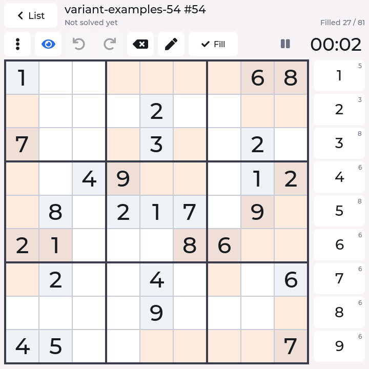

## The rules

[Classic](classic.md) rules, plus a few **shaded regions** of 5 to 9 cells: **no digit repeats in a region**. A region reaches over box borders (and across rows and columns), so it ties together cells that otherwise don't see each other. Regions never touch, not even at a corner, so each shaded patch is one region.

## On the board

- The regions are tinted, like the Asterisk's or Hyper's cells.
- Two of the same digit in a region turn red, as in a row.
- The hints count a region as one more group: "the row, column, box or shaded region".
- **Puzzles → ⋮ → New puzzle → Grids → Extra Regions**: 5 regions (Hard and Expert: up to 6).

## How to solve it

- **Scan a region like a short row:** a digit placed in it rules that digit out of its other cells, in whatever box they are.
- **Hidden singles across the border:** a region often leaves a box with one place for a digit.
- **Pairs travel:** two cells of a region that can only be 3 or 7 keep 3 and 7 out of the rest of the region.

## Worked example

**variant-examples #54**, Extra Regions Easy (see [Classic](classic.md#worked-example-the-whole-puzzle) for how to import the examples; cells are written r*row*c*column*).

**Step 1: the 9 in box 9.** r7c9 and r9c9 are filled. r8c7 to r8c9: row 8 has a 9 (r8c5). r7c8 and r9c8: column 8 has one (r5c8). r7c7 is in a shaded region with r5c8, which holds 9. Only **r9c7** is left: **r9c7 = 9**.

**Step 2: the 2 in box 1**, by the Classic rules: column 2 has a 2 (r7c2), row 2 one (r2c5), row 3 one (r3c8). **r1c3 = 2**.

**Step 3: the 9 in box 4**: row 4 has a 9 (r4c4), row 5 one (r5c8). **r6c3 = 9**.

## The whole puzzle, step by step

<!-- walkthrough -->
<!-- Written by tools/walkthrough.py extra-regions: edit the script, not this part. -->

The whole puzzle, from the start to the last cell: 54 steps, each one a single (one place left for a digit, or one digit left for a cell), taken in the order a box's single comes first, so not quite the order of the worked example above. In each picture, the unit the step looks at is tinted yellow (for a cell with one digit left: its row, column and box), the new digit is on green, the digits that rule cells out have an **orange ring**, and the empty cells they rule out a **red cross**. Givens are on grey, digits from earlier steps in blue.

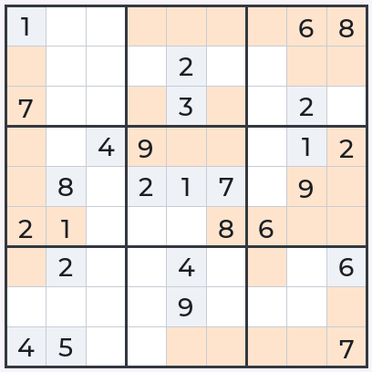

#### Step 1: the 2 in box 1

Box 1 needs a 2. r1c2: column 2 has one (r7c2). r2c1, r2c2 and r2c3: row 2 has one (r2c5). r3c2 and r3c3: row 3 has one (r3c8). Only **r1c3** is left: **r1c3 = 2**.

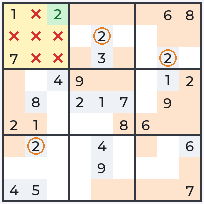

#### Step 2: the 9 in box 4

Box 4 needs a 9. r4c1 and r4c2: row 4 has one (r4c4). r5c1 and r5c3: row 5 has one (r5c8). Only **r6c3** is left: **r6c3 = 9**.

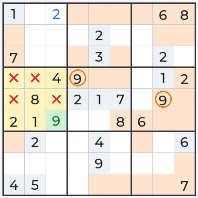

#### Step 3: the 7 in box 4

Box 4 needs a 7. r4c1: column 1 has one (r3c1). r5c1 and r5c3: row 5 has one (r5c6). Only **r4c2** is left: **r4c2 = 7**.

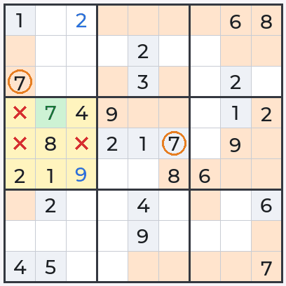

#### Step 4: the 4 in box 5

Box 5 needs a 4. r4c5 and r4c6: row 4 has one (r4c3). r6c5: column 5 has one (r7c5). Only **r6c4** is left: **r6c4 = 4**.

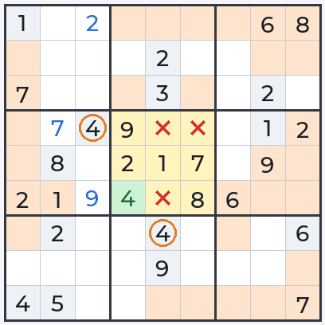

#### Step 5: the 3 in box 5

Box 5 needs a 3. r4c5 and r6c5: column 5 has one (r3c5). Only **r4c6** is left: **r4c6 = 3**.

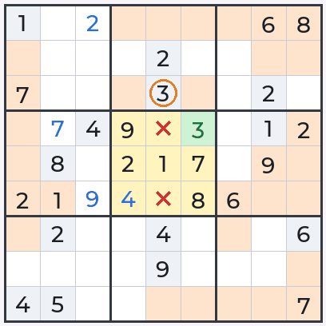

#### Step 6: the 6 in box 5

Box 5 needs a 6. r6c5: row 6 has one (r6c7). Only **r4c5** is left: **r4c5 = 6**.

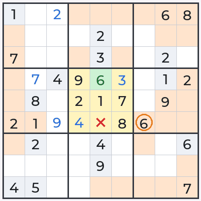

#### Step 7: the 5 in box 5

Box 5 needs a 5, and r6c5 is its last empty cell: **r6c5 = 5**.

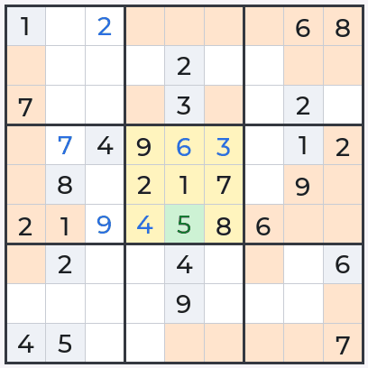

#### Step 8: the 7 in box 6

Box 6 needs a 7. r4c7: row 4 has one (r4c2). r5c7 and r5c9: row 5 has one (r5c6). r6c9: column 9 has one (r9c9). Only **r6c8** is left: **r6c8 = 7**.

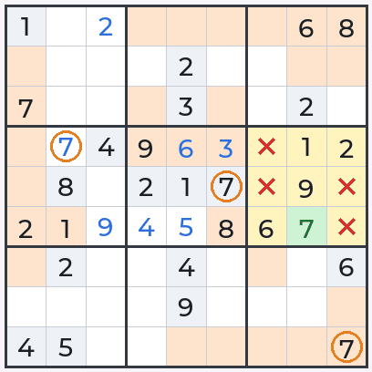

#### Step 9: the 8 in box 6

Box 6 needs an 8. r5c7 and r5c9: row 5 has one (r5c2). r6c9: row 6 has one (r6c6). Only **r4c7** is left: **r4c7 = 8**.

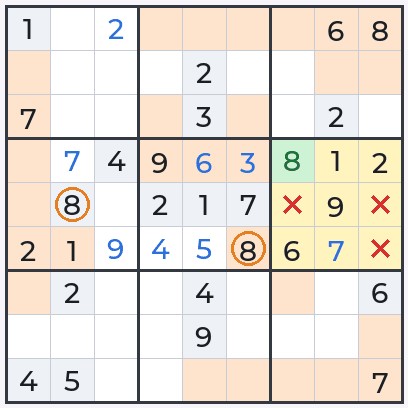

#### Step 10: the 9 in box 7

Box 7 needs a 9. r7c3 and r9c3: column 3 has one (r6c3). r8c1, r8c2 and r8c3: row 8 has one (r8c5). Only **r7c1** is left: **r7c1 = 9**.

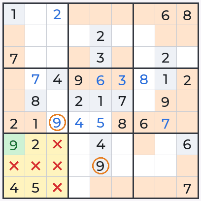

#### Step 11: the 9 in box 9

Box 9 needs a 9. r7c7 and r7c8: row 7 has one (r7c1). r8c7, r8c8 and r8c9: row 8 has one (r8c5). r9c8: column 8 has one (r5c8). Only **r9c7** is left: **r9c7 = 9**.

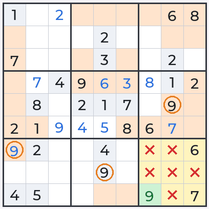

#### Step 12: the 2 in box 9

Box 9 needs a 2. r7c7 and r7c8: row 7 has one (r7c2). r8c8 and r9c8: column 8 has one (r3c8). r8c9: column 9 has one (r4c9). Only **r8c7** is left: **r8c7 = 2**.

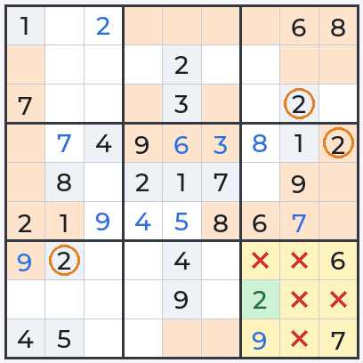

#### Step 13: the 2 in box 8

Box 8 needs a 2. r7c4 and r7c6: row 7 has one (r7c2). r8c4 and r8c6: row 8 has one (r8c7). r9c4: column 4 has one (r5c4). r9c5: column 5 has one (r2c5). Only **r9c6** is left: **r9c6 = 2**.

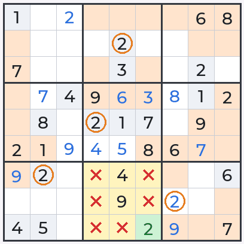

#### Step 14: the 5 in row 4

Row 4 needs a 5, and r4c1 is its last empty cell: **r4c1 = 5**.

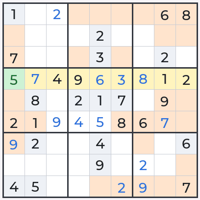

#### Step 15: the 3 in row 6

Row 6 needs a 3, and r6c9 is its last empty cell: **r6c9 = 3**.

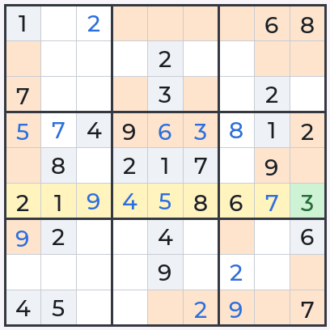

#### Step 16: the 7 in column 5

Column 5 needs a 7. r9c5: row 9 has one (r9c9). Only **r1c5** is left: **r1c5 = 7**.

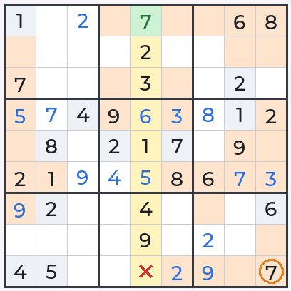

#### Step 17: the 7 in box 3

Box 3 needs a 7. r1c7: row 1 has one (r1c5). r2c8: column 8 has one (r6c8). r2c9: column 9 has one (r9c9). r3c7 and r3c9: row 3 has one (r3c1). Only **r2c7** is left: **r2c7 = 7**.

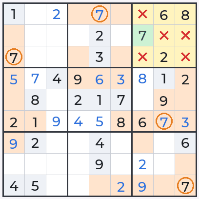

#### Step 18: the 8 in column 5

Column 5 needs an 8, and r9c5 is its last empty cell: **r9c5 = 8**.

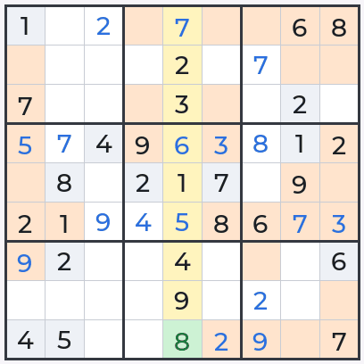

#### Step 19: the 3 in column 7

Column 7 needs a 3. r3c7: row 3 has one (r3c5). r5c7: box 6 has one (r6c9). r7c7: the 3 in r6c9 is in the same shaded region. Only **r1c7** is left: **r1c7 = 3**.

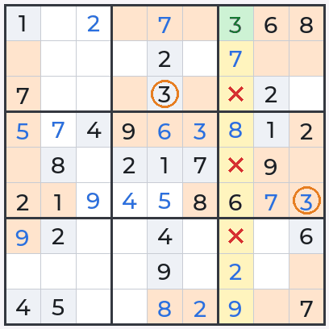

#### Step 20: r1c4

Row 1 has 1, 2, 3, 6, 7 and 8; column 4 has 4 and 9. Only 5 is left: **r1c4 = 5**.

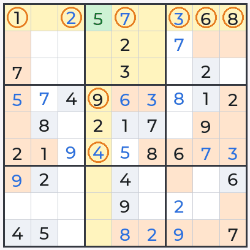

#### Step 21: the 5 in row 2

Row 2 needs a 5. r2c1: column 1 has one (r4c1). r2c2: column 2 has one (r9c2). r2c4: column 4 has one (r1c4). r2c6: box 2 has one (r1c4). r2c8 and r2c9: the 5 in r1c4 is in the same shaded region. Only **r2c3** is left: **r2c3 = 5**.

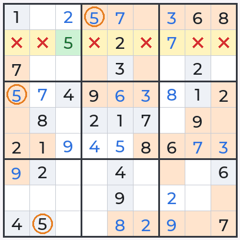

#### Step 22: r2c8

Column 8 has 1, 6 and 9; row 2 has 2, 5 and 7; box 3 has 3 and 8. Only 4 is left: **r2c8 = 4**.

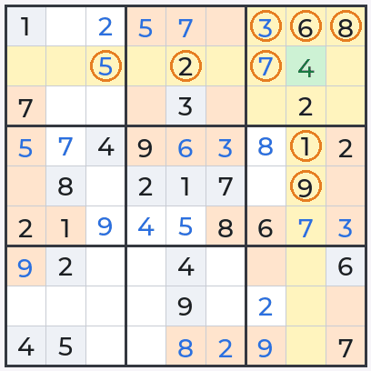

#### Step 23: the 4 in box 2

Box 2 needs a 4. r1c6: the 4 in r2c8 is in the same shaded region. r2c4 and r2c6: row 2 has one (r2c8). r3c4: column 4 has one (r6c4). Only **r3c6** is left: **r3c6 = 4**.

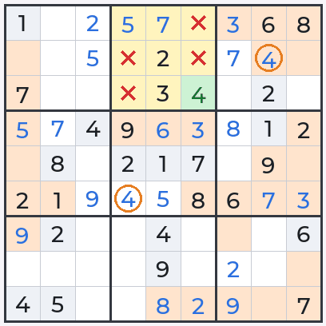

#### Step 24: the 4 in box 1

Box 1 needs a 4. r2c1 and r2c2: row 2 has one (r2c8). r3c2 and r3c3: row 3 has one (r3c6). Only **r1c2** is left: **r1c2 = 4**.

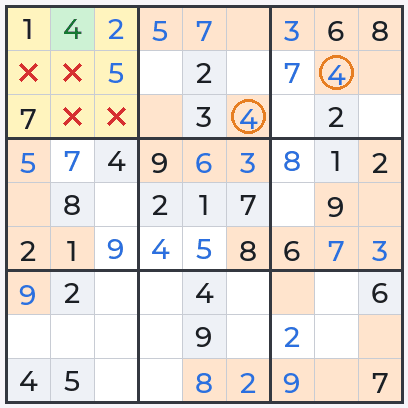

#### Step 25: the 4 in box 9

Box 9 needs a 4. r7c7 and r7c8: row 7 has one (r7c5). r8c8: column 8 has one (r2c8). r9c8: row 9 has one (r9c1). Only **r8c9** is left: **r8c9 = 4**.

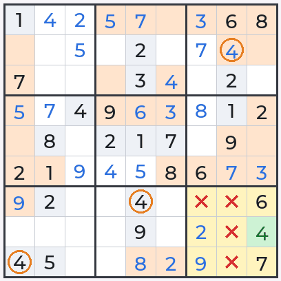

#### Step 26: the 4 in box 6

Box 6 needs a 4. r5c9: column 9 has one (r8c9). Only **r5c7** is left: **r5c7 = 4**.

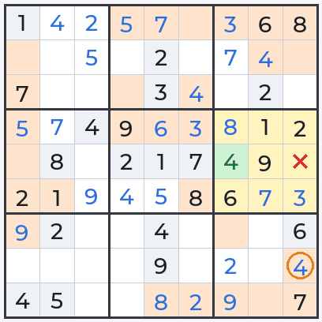

#### Step 27: the 5 in box 6

Box 6 needs a 5, and r5c9 is its last empty cell: **r5c9 = 5**.

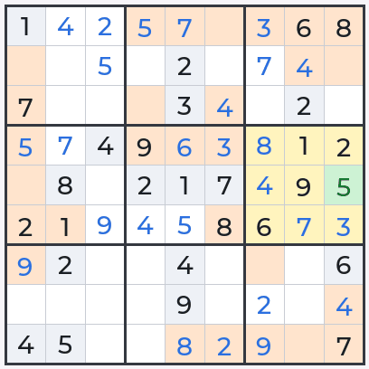

#### Step 28: the 5 in box 3

Box 3 needs a 5. r2c9: row 2 has one (r2c3). r3c9: column 9 has one (r5c9). Only **r3c7** is left: **r3c7 = 5**.

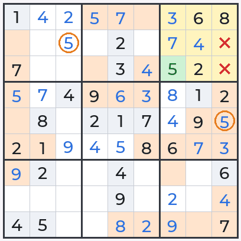

#### Step 29: the 1 in box 9

Box 9 needs a 1. r7c8, r8c8 and r9c8: column 8 has one (r4c8). Only **r7c7** is left: **r7c7 = 1**.

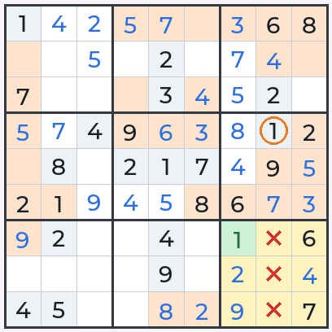

#### Step 30: the 9 in row 1

Row 1 needs a 9, and r1c6 is its last empty cell: **r1c6 = 9**.

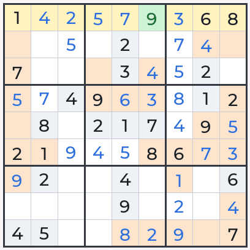

#### Step 31: the 9 in box 3

Box 3 needs a 9. r2c9: the 9 in r1c6 is in the same shaded region. Only **r3c9** is left: **r3c9 = 9**.

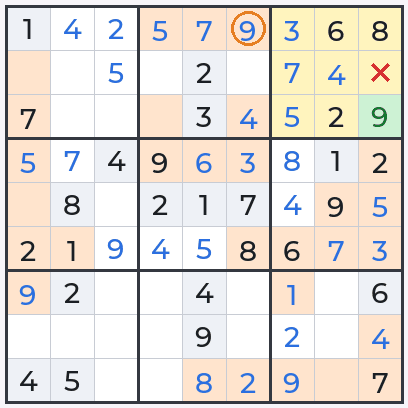

#### Step 32: the 9 in box 1

Box 1 needs a 9. r2c1: column 1 has one (r7c1). r3c2 and r3c3: row 3 has one (r3c9). Only **r2c2** is left: **r2c2 = 9**.

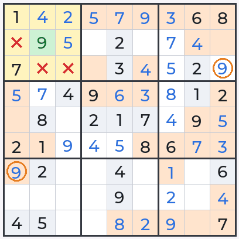

#### Step 33: the 3 in box 1

Box 1 needs a 3. r3c2 and r3c3: row 3 has one (r3c5). Only **r2c1** is left: **r2c1 = 3**.

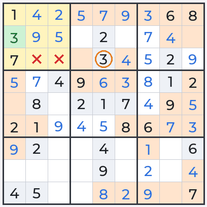

#### Step 34: the 8 in box 1

Box 1 needs an 8. r3c2: column 2 has one (r5c2). Only **r3c3** is left: **r3c3 = 8**.

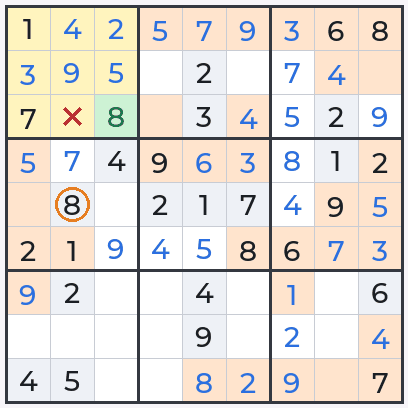

#### Step 35: the 6 in box 1

Box 1 needs a 6, and r3c2 is its last empty cell: **r3c2 = 6**.

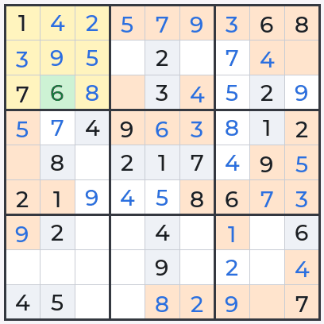

#### Step 36: the 8 in box 2

Box 2 needs an 8. r2c6: column 6 has one (r6c6). r3c4: row 3 has one (r3c3). Only **r2c4** is left: **r2c4 = 8**.

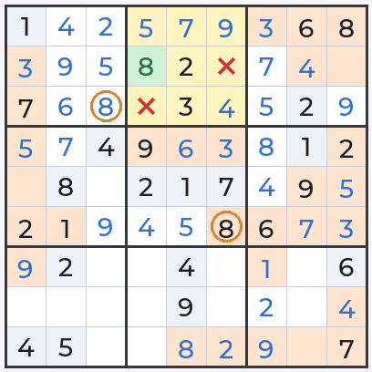

#### Step 37: the 6 in box 2

Box 2 needs a 6. r3c4: row 3 has one (r3c2). Only **r2c6** is left: **r2c6 = 6**.

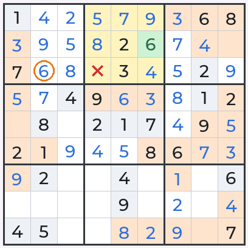

#### Step 38: the 1 in box 2

Box 2 needs a 1, and r3c4 is its last empty cell: **r3c4 = 1**.

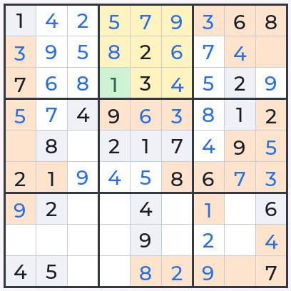

#### Step 39: the 1 in box 3

Box 3 needs a 1, and r2c9 is its last empty cell: **r2c9 = 1**.

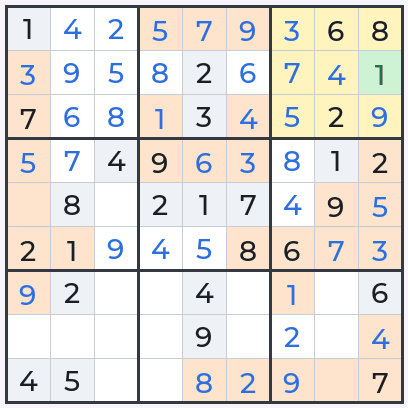

#### Step 40: the 3 in box 4

Box 4 needs a 3. r5c1: column 1 has one (r2c1). Only **r5c3** is left: **r5c3 = 3**.

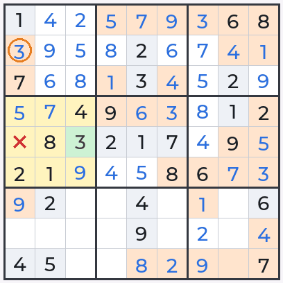

#### Step 41: the 6 in box 4

Box 4 needs a 6, and r5c1 is its last empty cell: **r5c1 = 6**.

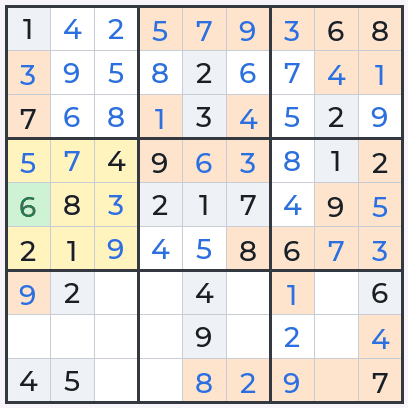

#### Step 42: the 3 in box 7

Box 7 needs a 3. r7c3, r8c3 and r9c3: column 3 has one (r5c3). r8c1: column 1 has one (r2c1). Only **r8c2** is left: **r8c2 = 3**.

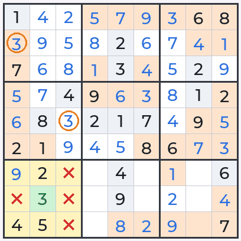

#### Step 43: the 8 in box 7

Box 7 needs an 8. r7c3 and r8c3: column 3 has one (r3c3). r9c3: row 9 has one (r9c5). Only **r8c1** is left: **r8c1 = 8**.

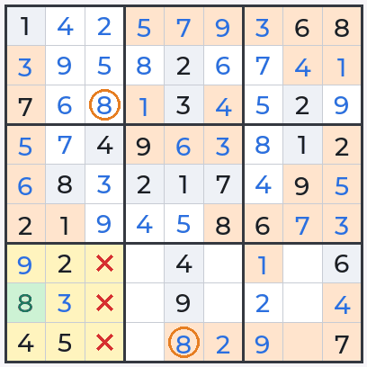

#### Step 44: the 1 in box 8

Box 8 needs a 1. r7c4 and r7c6: row 7 has one (r7c7). r8c4 and r9c4: column 4 has one (r3c4). Only **r8c6** is left: **r8c6 = 1**.

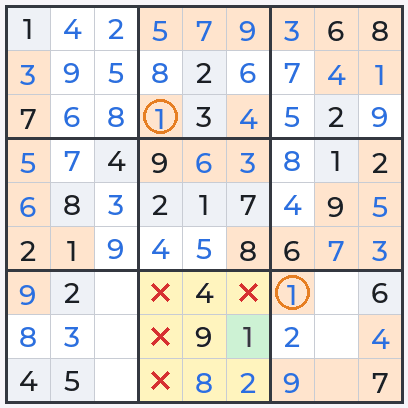

#### Step 45: the 1 in box 7

Box 7 needs a 1. r7c3: row 7 has one (r7c7). r8c3: row 8 has one (r8c6). Only **r9c3** is left: **r9c3 = 1**.

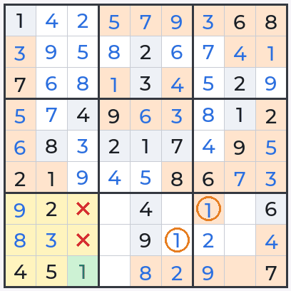

#### Step 46: the 6 in box 7

Box 7 needs a 6. r7c3: row 7 has one (r7c9). Only **r8c3** is left: **r8c3 = 6**.

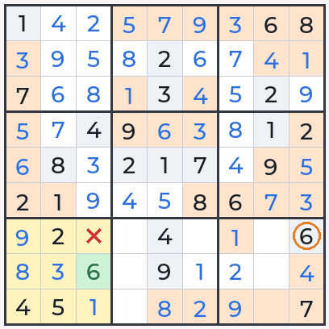

#### Step 47: the 7 in box 7

Box 7 needs a 7, and r7c3 is its last empty cell: **r7c3 = 7**.

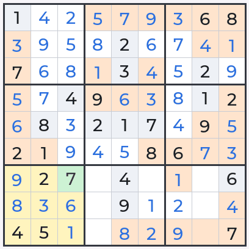

#### Step 48: the 5 in box 8

Box 8 needs a 5. r7c4 and r8c4: column 4 has one (r1c4). r9c4: row 9 has one (r9c2). Only **r7c6** is left: **r7c6 = 5**.

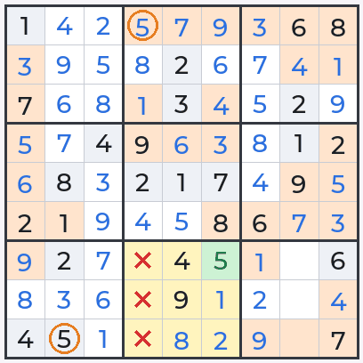

#### Step 49: the 6 in box 8

Box 8 needs a 6. r7c4: row 7 has one (r7c9). r8c4: row 8 has one (r8c3). Only **r9c4** is left: **r9c4 = 6**.

#### Step 50: the 3 in box 8

Box 8 needs a 3. r8c4: row 8 has one (r8c2). Only **r7c4** is left: **r7c4 = 3**.

#### Step 51: the 7 in box 8

Box 8 needs a 7, and r8c4 is its last empty cell: **r8c4 = 7**.

#### Step 52: the 3 in box 9

Box 9 needs a 3. r7c8: row 7 has one (r7c4). r8c8: row 8 has one (r8c2). Only **r9c8** is left: **r9c8 = 3**.

#### Step 53: the 5 in box 9

Box 9 needs a 5. r7c8: row 7 has one (r7c6). Only **r8c8** is left: **r8c8 = 5**.

#### Step 54: the 8 in box 9

Box 9 needs an 8, and r7c8 is its last empty cell: **r7c8 = 8**.

Solved.

<!-- /walkthrough -->
