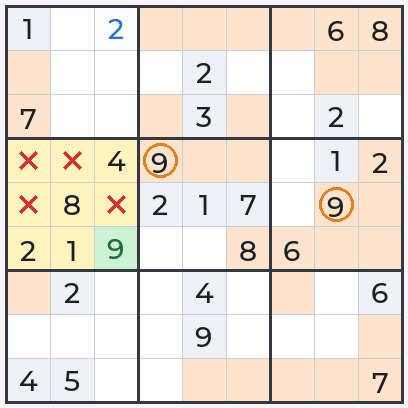

<!-- Written by tools/walkthrough.py extra-regions: edit the script, not this page. -->
# Extra Regions, step 2: the 9 in box 4

**Step 2 of 54** · [← Step 1](step-01.md) · [All steps](../extra-regions.md#the-whole-puzzle-step-by-step) · [Step 3 →](step-03.md)

Box 4 needs a 9. r4c1 and r4c2: row 4 has one (r4c4). r5c1 and r5c3: row 5 has one (r5c8). Only **r6c3** is left: **r6c3 = 9**.

**Step 2 of 54** · [← Step 1](step-01.md) · [All steps](../extra-regions.md#the-whole-puzzle-step-by-step) · [Step 3 →](step-03.md)
