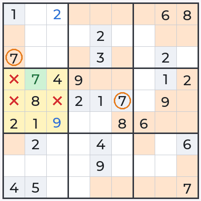

<!-- Written by tools/walkthrough.py extra-regions: edit the script, not this page. -->
# Extra Regions, step 3: the 7 in box 4

**Step 3 of 54** · [← Step 2](step-02.md) · [All steps](../extra-regions.md#the-whole-puzzle-step-by-step) · [Step 4 →](step-04.md)

Box 4 needs a 7. r4c1: column 1 has one (r3c1). r5c1 and r5c3: row 5 has one (r5c6). Only **r4c2** is left: **r4c2 = 7**.

**Step 3 of 54** · [← Step 2](step-02.md) · [All steps](../extra-regions.md#the-whole-puzzle-step-by-step) · [Step 4 →](step-04.md)
