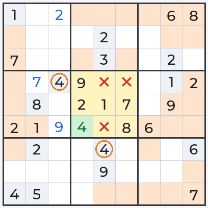

<!-- Written by tools/walkthrough.py extra-regions: edit the script, not this page. -->
# Extra Regions, step 4: the 4 in box 5

**Step 4 of 54** · [← Step 3](step-03.md) · [All steps](../extra-regions.md#the-whole-puzzle-step-by-step) · [Step 5 →](step-05.md)

Box 5 needs a 4. r4c5 and r4c6: row 4 has one (r4c3). r6c5: column 5 has one (r7c5). Only **r6c4** is left: **r6c4 = 4**.

**Step 4 of 54** · [← Step 3](step-03.md) · [All steps](../extra-regions.md#the-whole-puzzle-step-by-step) · [Step 5 →](step-05.md)
