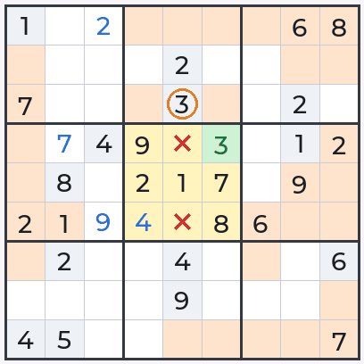

<!-- Written by tools/walkthrough.py extra-regions: edit the script, not this page. -->
# Extra Regions, step 5: the 3 in box 5

**Step 5 of 54** · [← Step 4](step-04.md) · [All steps](../extra-regions.md#the-whole-puzzle-step-by-step) · [Step 6 →](step-06.md)

Box 5 needs a 3. r4c5 and r6c5: column 5 has one (r3c5). Only **r4c6** is left: **r4c6 = 3**.

**Step 5 of 54** · [← Step 4](step-04.md) · [All steps](../extra-regions.md#the-whole-puzzle-step-by-step) · [Step 6 →](step-06.md)
