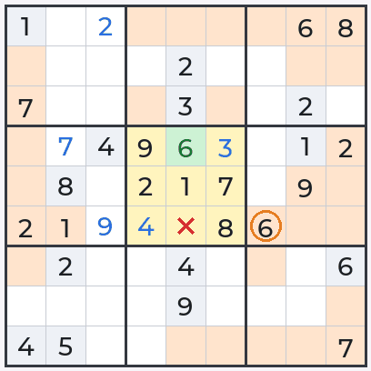

<!-- Written by tools/walkthrough.py extra-regions: edit the script, not this page. -->
# Extra Regions, step 6: the 6 in box 5

**Step 6 of 54** · [← Step 5](step-05.md) · [All steps](../extra-regions.md#the-whole-puzzle-step-by-step) · [Step 7 →](step-07.md)

Box 5 needs a 6. r6c5: row 6 has one (r6c7). Only **r4c5** is left: **r4c5 = 6**.

**Step 6 of 54** · [← Step 5](step-05.md) · [All steps](../extra-regions.md#the-whole-puzzle-step-by-step) · [Step 7 →](step-07.md)
