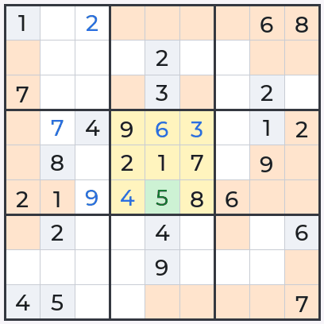

<!-- Written by tools/walkthrough.py extra-regions: edit the script, not this page. -->
# Extra Regions, step 7: the 5 in box 5

**Step 7 of 54** · [← Step 6](step-06.md) · [All steps](../extra-regions.md#the-whole-puzzle-step-by-step) · [Step 8 →](step-08.md)

Box 5 needs a 5, and r6c5 is its last empty cell: **r6c5 = 5**.

**Step 7 of 54** · [← Step 6](step-06.md) · [All steps](../extra-regions.md#the-whole-puzzle-step-by-step) · [Step 8 →](step-08.md)
