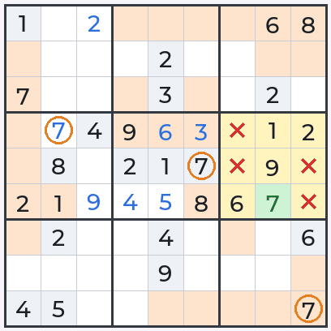

<!-- Written by tools/walkthrough.py extra-regions: edit the script, not this page. -->
# Extra Regions, step 8: the 7 in box 6

**Step 8 of 54** · [← Step 7](step-07.md) · [All steps](../extra-regions.md#the-whole-puzzle-step-by-step) · [Step 9 →](step-09.md)

Box 6 needs a 7. r4c7: row 4 has one (r4c2). r5c7 and r5c9: row 5 has one (r5c6). r6c9: column 9 has one (r9c9). Only **r6c8** is left: **r6c8 = 7**.

**Step 8 of 54** · [← Step 7](step-07.md) · [All steps](../extra-regions.md#the-whole-puzzle-step-by-step) · [Step 9 →](step-09.md)
