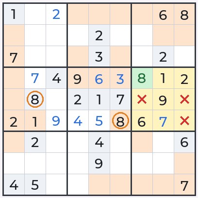

<!-- Written by tools/walkthrough.py extra-regions: edit the script, not this page. -->
# Extra Regions, step 9: the 8 in box 6

**Step 9 of 54** · [← Step 8](step-08.md) · [All steps](../extra-regions.md#the-whole-puzzle-step-by-step) · [Step 10 →](step-10.md)

Box 6 needs an 8. r5c7 and r5c9: row 5 has one (r5c2). r6c9: row 6 has one (r6c6). Only **r4c7** is left: **r4c7 = 8**.

**Step 9 of 54** · [← Step 8](step-08.md) · [All steps](../extra-regions.md#the-whole-puzzle-step-by-step) · [Step 10 →](step-10.md)
