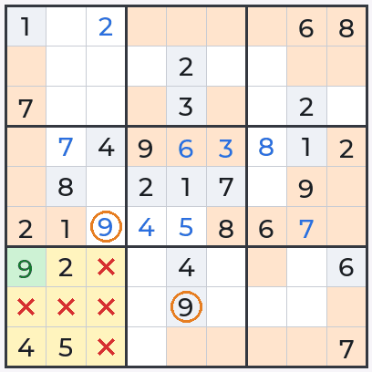

<!-- Written by tools/walkthrough.py extra-regions: edit the script, not this page. -->
# Extra Regions, step 10: the 9 in box 7

**Step 10 of 54** · [← Step 9](step-09.md) · [All steps](../extra-regions.md#the-whole-puzzle-step-by-step) · [Step 11 →](step-11.md)

Box 7 needs a 9. r7c3 and r9c3: column 3 has one (r6c3). r8c1, r8c2 and r8c3: row 8 has one (r8c5). Only **r7c1** is left: **r7c1 = 9**.

**Step 10 of 54** · [← Step 9](step-09.md) · [All steps](../extra-regions.md#the-whole-puzzle-step-by-step) · [Step 11 →](step-11.md)
