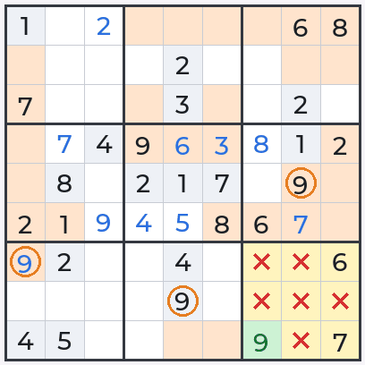

<!-- Written by tools/walkthrough.py extra-regions: edit the script, not this page. -->
# Extra Regions, step 11: the 9 in box 9

**Step 11 of 54** · [← Step 10](step-10.md) · [All steps](../extra-regions.md#the-whole-puzzle-step-by-step) · [Step 12 →](step-12.md)

Box 9 needs a 9. r7c7 and r7c8: row 7 has one (r7c1). r8c7, r8c8 and r8c9: row 8 has one (r8c5). r9c8: column 8 has one (r5c8). Only **r9c7** is left: **r9c7 = 9**.

**Step 11 of 54** · [← Step 10](step-10.md) · [All steps](../extra-regions.md#the-whole-puzzle-step-by-step) · [Step 12 →](step-12.md)
