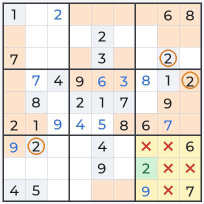

<!-- Written by tools/walkthrough.py extra-regions: edit the script, not this page. -->
# Extra Regions, step 12: the 2 in box 9

**Step 12 of 54** · [← Step 11](step-11.md) · [All steps](../extra-regions.md#the-whole-puzzle-step-by-step) · [Step 13 →](step-13.md)

Box 9 needs a 2. r7c7 and r7c8: row 7 has one (r7c2). r8c8 and r9c8: column 8 has one (r3c8). r8c9: column 9 has one (r4c9). Only **r8c7** is left: **r8c7 = 2**.

**Step 12 of 54** · [← Step 11](step-11.md) · [All steps](../extra-regions.md#the-whole-puzzle-step-by-step) · [Step 13 →](step-13.md)
