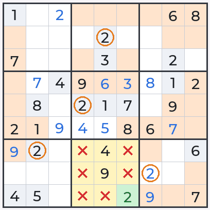

<!-- Written by tools/walkthrough.py extra-regions: edit the script, not this page. -->
# Extra Regions, step 13: the 2 in box 8

**Step 13 of 54** · [← Step 12](step-12.md) · [All steps](../extra-regions.md#the-whole-puzzle-step-by-step) · [Step 14 →](step-14.md)

Box 8 needs a 2. r7c4 and r7c6: row 7 has one (r7c2). r8c4 and r8c6: row 8 has one (r8c7). r9c4: column 4 has one (r5c4). r9c5: column 5 has one (r2c5). Only **r9c6** is left: **r9c6 = 2**.

**Step 13 of 54** · [← Step 12](step-12.md) · [All steps](../extra-regions.md#the-whole-puzzle-step-by-step) · [Step 14 →](step-14.md)
