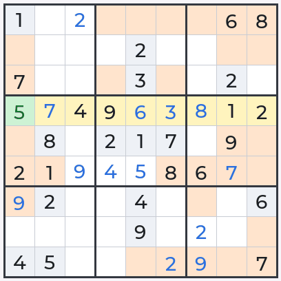

<!-- Written by tools/walkthrough.py extra-regions: edit the script, not this page. -->
# Extra Regions, step 14: the 5 in row 4

**Step 14 of 54** · [← Step 13](step-13.md) · [All steps](../extra-regions.md#the-whole-puzzle-step-by-step) · [Step 15 →](step-15.md)

Row 4 needs a 5, and r4c1 is its last empty cell: **r4c1 = 5**.

**Step 14 of 54** · [← Step 13](step-13.md) · [All steps](../extra-regions.md#the-whole-puzzle-step-by-step) · [Step 15 →](step-15.md)
