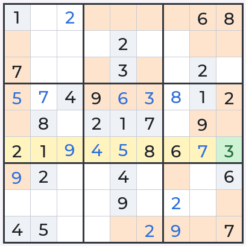

<!-- Written by tools/walkthrough.py extra-regions: edit the script, not this page. -->
# Extra Regions, step 15: the 3 in row 6

**Step 15 of 54** · [← Step 14](step-14.md) · [All steps](../extra-regions.md#the-whole-puzzle-step-by-step) · [Step 16 →](step-16.md)

Row 6 needs a 3, and r6c9 is its last empty cell: **r6c9 = 3**.

**Step 15 of 54** · [← Step 14](step-14.md) · [All steps](../extra-regions.md#the-whole-puzzle-step-by-step) · [Step 16 →](step-16.md)
