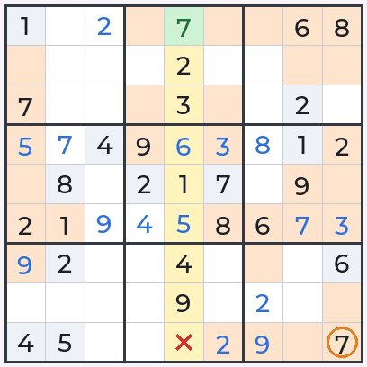

<!-- Written by tools/walkthrough.py extra-regions: edit the script, not this page. -->
# Extra Regions, step 16: the 7 in column 5

**Step 16 of 54** · [← Step 15](step-15.md) · [All steps](../extra-regions.md#the-whole-puzzle-step-by-step) · [Step 17 →](step-17.md)

Column 5 needs a 7. r9c5: row 9 has one (r9c9). Only **r1c5** is left: **r1c5 = 7**.

**Step 16 of 54** · [← Step 15](step-15.md) · [All steps](../extra-regions.md#the-whole-puzzle-step-by-step) · [Step 17 →](step-17.md)
