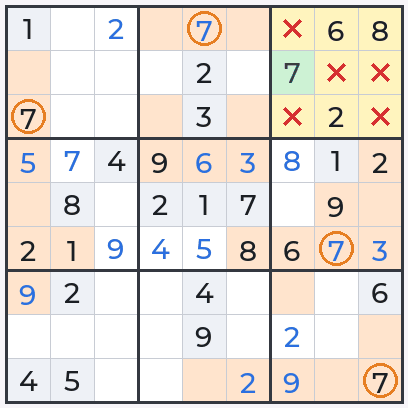

<!-- Written by tools/walkthrough.py extra-regions: edit the script, not this page. -->
# Extra Regions, step 17: the 7 in box 3

**Step 17 of 54** · [← Step 16](step-16.md) · [All steps](../extra-regions.md#the-whole-puzzle-step-by-step) · [Step 18 →](step-18.md)

Box 3 needs a 7. r1c7: row 1 has one (r1c5). r2c8: column 8 has one (r6c8). r2c9: column 9 has one (r9c9). r3c7 and r3c9: row 3 has one (r3c1). Only **r2c7** is left: **r2c7 = 7**.

**Step 17 of 54** · [← Step 16](step-16.md) · [All steps](../extra-regions.md#the-whole-puzzle-step-by-step) · [Step 18 →](step-18.md)
