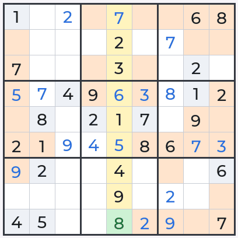

<!-- Written by tools/walkthrough.py extra-regions: edit the script, not this page. -->
# Extra Regions, step 18: the 8 in column 5

**Step 18 of 54** · [← Step 17](step-17.md) · [All steps](../extra-regions.md#the-whole-puzzle-step-by-step) · [Step 19 →](step-19.md)

Column 5 needs an 8, and r9c5 is its last empty cell: **r9c5 = 8**.

**Step 18 of 54** · [← Step 17](step-17.md) · [All steps](../extra-regions.md#the-whole-puzzle-step-by-step) · [Step 19 →](step-19.md)
