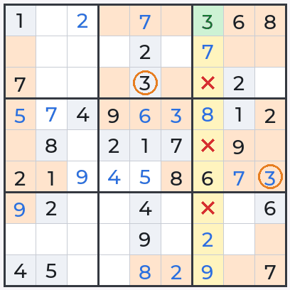

<!-- Written by tools/walkthrough.py extra-regions: edit the script, not this page. -->
# Extra Regions, step 19: the 3 in column 7

**Step 19 of 54** · [← Step 18](step-18.md) · [All steps](../extra-regions.md#the-whole-puzzle-step-by-step) · [Step 20 →](step-20.md)

Column 7 needs a 3. r3c7: row 3 has one (r3c5). r5c7: box 6 has one (r6c9). r7c7: the 3 in r6c9 is in the same shaded region. Only **r1c7** is left: **r1c7 = 3**.

**Step 19 of 54** · [← Step 18](step-18.md) · [All steps](../extra-regions.md#the-whole-puzzle-step-by-step) · [Step 20 →](step-20.md)
