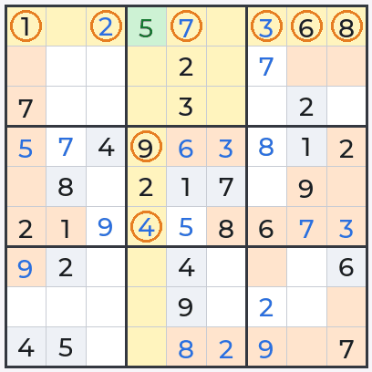

<!-- Written by tools/walkthrough.py extra-regions: edit the script, not this page. -->
# Extra Regions, step 20: r1c4

**Step 20 of 54** · [← Step 19](step-19.md) · [All steps](../extra-regions.md#the-whole-puzzle-step-by-step) · [Step 21 →](step-21.md)

Row 1 has 1, 2, 3, 6, 7 and 8; column 4 has 4 and 9. Only 5 is left: **r1c4 = 5**.

**Step 20 of 54** · [← Step 19](step-19.md) · [All steps](../extra-regions.md#the-whole-puzzle-step-by-step) · [Step 21 →](step-21.md)
