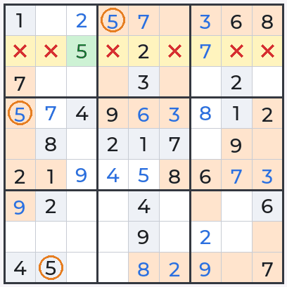

<!-- Written by tools/walkthrough.py extra-regions: edit the script, not this page. -->
# Extra Regions, step 21: the 5 in row 2

**Step 21 of 54** · [← Step 20](step-20.md) · [All steps](../extra-regions.md#the-whole-puzzle-step-by-step) · [Step 22 →](step-22.md)

Row 2 needs a 5. r2c1: column 1 has one (r4c1). r2c2: column 2 has one (r9c2). r2c4: column 4 has one (r1c4). r2c6: box 2 has one (r1c4). r2c8 and r2c9: the 5 in r1c4 is in the same shaded region. Only **r2c3** is left: **r2c3 = 5**.

**Step 21 of 54** · [← Step 20](step-20.md) · [All steps](../extra-regions.md#the-whole-puzzle-step-by-step) · [Step 22 →](step-22.md)
