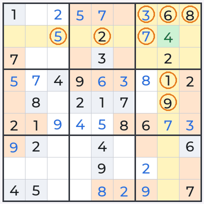

<!-- Written by tools/walkthrough.py extra-regions: edit the script, not this page. -->
# Extra Regions, step 22: r2c8

**Step 22 of 54** · [← Step 21](step-21.md) · [All steps](../extra-regions.md#the-whole-puzzle-step-by-step) · [Step 23 →](step-23.md)

Column 8 has 1, 6 and 9; row 2 has 2, 5 and 7; box 3 has 3 and 8. Only 4 is left: **r2c8 = 4**.

**Step 22 of 54** · [← Step 21](step-21.md) · [All steps](../extra-regions.md#the-whole-puzzle-step-by-step) · [Step 23 →](step-23.md)
