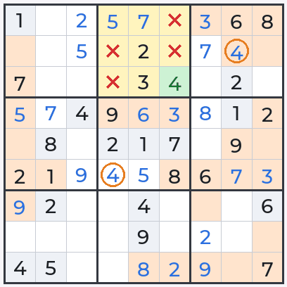

<!-- Written by tools/walkthrough.py extra-regions: edit the script, not this page. -->
# Extra Regions, step 23: the 4 in box 2

**Step 23 of 54** · [← Step 22](step-22.md) · [All steps](../extra-regions.md#the-whole-puzzle-step-by-step) · [Step 24 →](step-24.md)

Box 2 needs a 4. r1c6: the 4 in r2c8 is in the same shaded region. r2c4 and r2c6: row 2 has one (r2c8). r3c4: column 4 has one (r6c4). Only **r3c6** is left: **r3c6 = 4**.

**Step 23 of 54** · [← Step 22](step-22.md) · [All steps](../extra-regions.md#the-whole-puzzle-step-by-step) · [Step 24 →](step-24.md)
