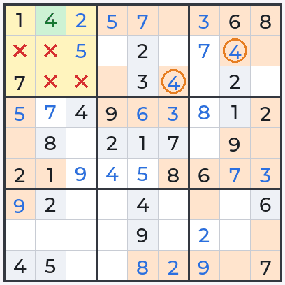

<!-- Written by tools/walkthrough.py extra-regions: edit the script, not this page. -->
# Extra Regions, step 24: the 4 in box 1

**Step 24 of 54** · [← Step 23](step-23.md) · [All steps](../extra-regions.md#the-whole-puzzle-step-by-step) · [Step 25 →](step-25.md)

Box 1 needs a 4. r2c1 and r2c2: row 2 has one (r2c8). r3c2 and r3c3: row 3 has one (r3c6). Only **r1c2** is left: **r1c2 = 4**.

**Step 24 of 54** · [← Step 23](step-23.md) · [All steps](../extra-regions.md#the-whole-puzzle-step-by-step) · [Step 25 →](step-25.md)
