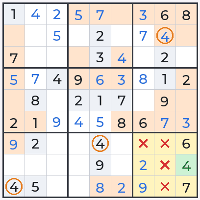

<!-- Written by tools/walkthrough.py extra-regions: edit the script, not this page. -->
# Extra Regions, step 25: the 4 in box 9

**Step 25 of 54** · [← Step 24](step-24.md) · [All steps](../extra-regions.md#the-whole-puzzle-step-by-step) · [Step 26 →](step-26.md)

Box 9 needs a 4. r7c7 and r7c8: row 7 has one (r7c5). r8c8: column 8 has one (r2c8). r9c8: row 9 has one (r9c1). Only **r8c9** is left: **r8c9 = 4**.

**Step 25 of 54** · [← Step 24](step-24.md) · [All steps](../extra-regions.md#the-whole-puzzle-step-by-step) · [Step 26 →](step-26.md)
