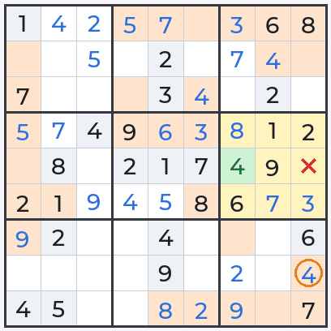

<!-- Written by tools/walkthrough.py extra-regions: edit the script, not this page. -->
# Extra Regions, step 26: the 4 in box 6

**Step 26 of 54** · [← Step 25](step-25.md) · [All steps](../extra-regions.md#the-whole-puzzle-step-by-step) · [Step 27 →](step-27.md)

Box 6 needs a 4. r5c9: column 9 has one (r8c9). Only **r5c7** is left: **r5c7 = 4**.

**Step 26 of 54** · [← Step 25](step-25.md) · [All steps](../extra-regions.md#the-whole-puzzle-step-by-step) · [Step 27 →](step-27.md)
