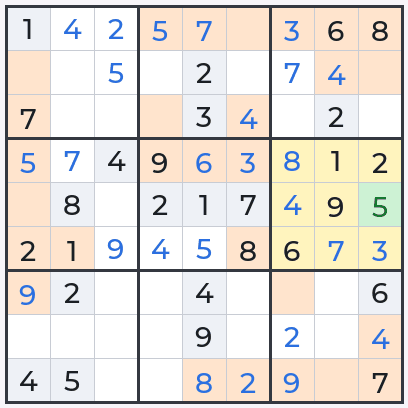

<!-- Written by tools/walkthrough.py extra-regions: edit the script, not this page. -->
# Extra Regions, step 27: the 5 in box 6

**Step 27 of 54** · [← Step 26](step-26.md) · [All steps](../extra-regions.md#the-whole-puzzle-step-by-step) · [Step 28 →](step-28.md)

Box 6 needs a 5, and r5c9 is its last empty cell: **r5c9 = 5**.

**Step 27 of 54** · [← Step 26](step-26.md) · [All steps](../extra-regions.md#the-whole-puzzle-step-by-step) · [Step 28 →](step-28.md)
