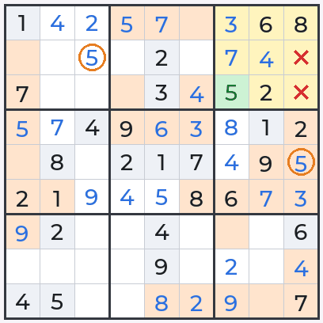

<!-- Written by tools/walkthrough.py extra-regions: edit the script, not this page. -->
# Extra Regions, step 28: the 5 in box 3

**Step 28 of 54** · [← Step 27](step-27.md) · [All steps](../extra-regions.md#the-whole-puzzle-step-by-step) · [Step 29 →](step-29.md)

Box 3 needs a 5. r2c9: row 2 has one (r2c3). r3c9: column 9 has one (r5c9). Only **r3c7** is left: **r3c7 = 5**.

**Step 28 of 54** · [← Step 27](step-27.md) · [All steps](../extra-regions.md#the-whole-puzzle-step-by-step) · [Step 29 →](step-29.md)
