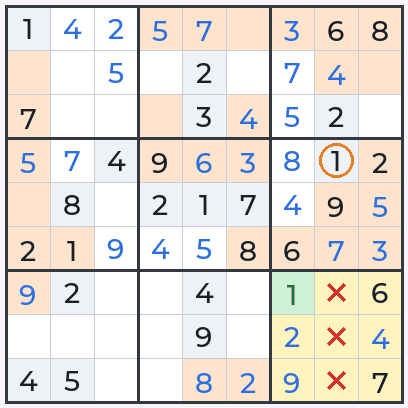

<!-- Written by tools/walkthrough.py extra-regions: edit the script, not this page. -->
# Extra Regions, step 29: the 1 in box 9

**Step 29 of 54** · [← Step 28](step-28.md) · [All steps](../extra-regions.md#the-whole-puzzle-step-by-step) · [Step 30 →](step-30.md)

Box 9 needs a 1. r7c8, r8c8 and r9c8: column 8 has one (r4c8). Only **r7c7** is left: **r7c7 = 1**.

**Step 29 of 54** · [← Step 28](step-28.md) · [All steps](../extra-regions.md#the-whole-puzzle-step-by-step) · [Step 30 →](step-30.md)
