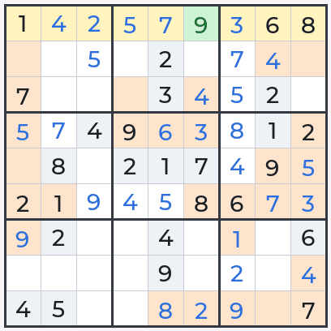

<!-- Written by tools/walkthrough.py extra-regions: edit the script, not this page. -->
# Extra Regions, step 30: the 9 in row 1

**Step 30 of 54** · [← Step 29](step-29.md) · [All steps](../extra-regions.md#the-whole-puzzle-step-by-step) · [Step 31 →](step-31.md)

Row 1 needs a 9, and r1c6 is its last empty cell: **r1c6 = 9**.

**Step 30 of 54** · [← Step 29](step-29.md) · [All steps](../extra-regions.md#the-whole-puzzle-step-by-step) · [Step 31 →](step-31.md)
