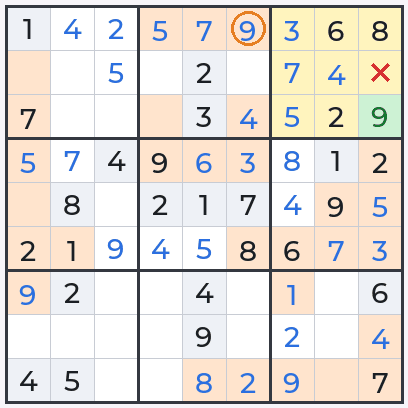

<!-- Written by tools/walkthrough.py extra-regions: edit the script, not this page. -->
# Extra Regions, step 31: the 9 in box 3

**Step 31 of 54** · [← Step 30](step-30.md) · [All steps](../extra-regions.md#the-whole-puzzle-step-by-step) · [Step 32 →](step-32.md)

Box 3 needs a 9. r2c9: the 9 in r1c6 is in the same shaded region. Only **r3c9** is left: **r3c9 = 9**.

**Step 31 of 54** · [← Step 30](step-30.md) · [All steps](../extra-regions.md#the-whole-puzzle-step-by-step) · [Step 32 →](step-32.md)
