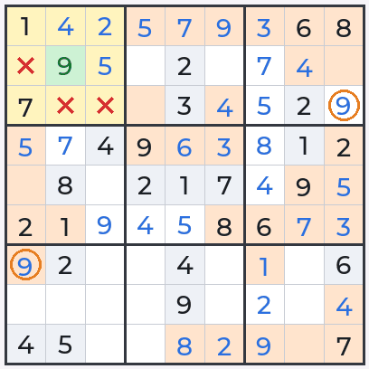

<!-- Written by tools/walkthrough.py extra-regions: edit the script, not this page. -->
# Extra Regions, step 32: the 9 in box 1

**Step 32 of 54** · [← Step 31](step-31.md) · [All steps](../extra-regions.md#the-whole-puzzle-step-by-step) · [Step 33 →](step-33.md)

Box 1 needs a 9. r2c1: column 1 has one (r7c1). r3c2 and r3c3: row 3 has one (r3c9). Only **r2c2** is left: **r2c2 = 9**.

**Step 32 of 54** · [← Step 31](step-31.md) · [All steps](../extra-regions.md#the-whole-puzzle-step-by-step) · [Step 33 →](step-33.md)
