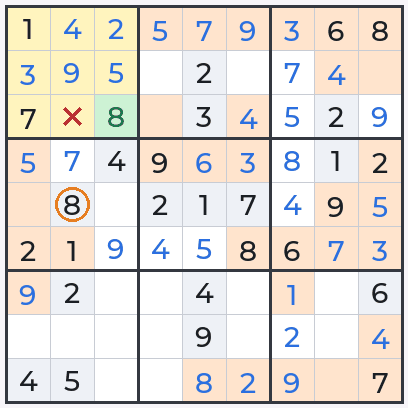

<!-- Written by tools/walkthrough.py extra-regions: edit the script, not this page. -->
# Extra Regions, step 34: the 8 in box 1

**Step 34 of 54** · [← Step 33](step-33.md) · [All steps](../extra-regions.md#the-whole-puzzle-step-by-step) · [Step 35 →](step-35.md)

Box 1 needs an 8. r3c2: column 2 has one (r5c2). Only **r3c3** is left: **r3c3 = 8**.

**Step 34 of 54** · [← Step 33](step-33.md) · [All steps](../extra-regions.md#the-whole-puzzle-step-by-step) · [Step 35 →](step-35.md)
