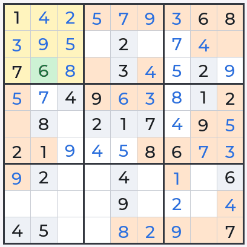

<!-- Written by tools/walkthrough.py extra-regions: edit the script, not this page. -->
# Extra Regions, step 35: the 6 in box 1

**Step 35 of 54** · [← Step 34](step-34.md) · [All steps](../extra-regions.md#the-whole-puzzle-step-by-step) · [Step 36 →](step-36.md)

Box 1 needs a 6, and r3c2 is its last empty cell: **r3c2 = 6**.

**Step 35 of 54** · [← Step 34](step-34.md) · [All steps](../extra-regions.md#the-whole-puzzle-step-by-step) · [Step 36 →](step-36.md)
