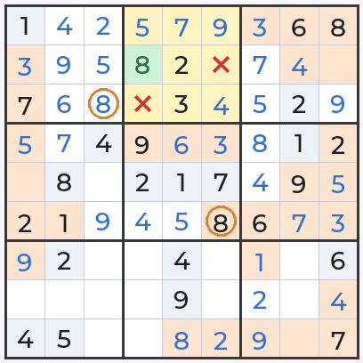

<!-- Written by tools/walkthrough.py extra-regions: edit the script, not this page. -->
# Extra Regions, step 36: the 8 in box 2

**Step 36 of 54** · [← Step 35](step-35.md) · [All steps](../extra-regions.md#the-whole-puzzle-step-by-step) · [Step 37 →](step-37.md)

Box 2 needs an 8. r2c6: column 6 has one (r6c6). r3c4: row 3 has one (r3c3). Only **r2c4** is left: **r2c4 = 8**.

**Step 36 of 54** · [← Step 35](step-35.md) · [All steps](../extra-regions.md#the-whole-puzzle-step-by-step) · [Step 37 →](step-37.md)
