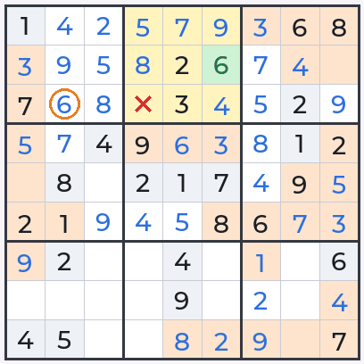

<!-- Written by tools/walkthrough.py extra-regions: edit the script, not this page. -->
# Extra Regions, step 37: the 6 in box 2

**Step 37 of 54** · [← Step 36](step-36.md) · [All steps](../extra-regions.md#the-whole-puzzle-step-by-step) · [Step 38 →](step-38.md)

Box 2 needs a 6. r3c4: row 3 has one (r3c2). Only **r2c6** is left: **r2c6 = 6**.

**Step 37 of 54** · [← Step 36](step-36.md) · [All steps](../extra-regions.md#the-whole-puzzle-step-by-step) · [Step 38 →](step-38.md)
