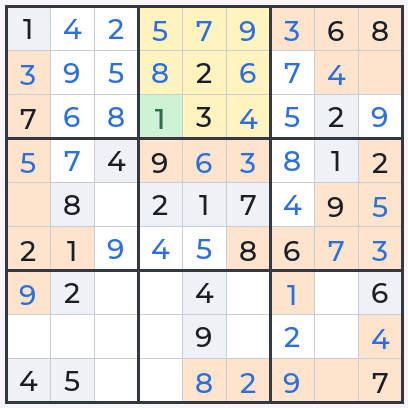

<!-- Written by tools/walkthrough.py extra-regions: edit the script, not this page. -->
# Extra Regions, step 38: the 1 in box 2

**Step 38 of 54** · [← Step 37](step-37.md) · [All steps](../extra-regions.md#the-whole-puzzle-step-by-step) · [Step 39 →](step-39.md)

Box 2 needs a 1, and r3c4 is its last empty cell: **r3c4 = 1**.

**Step 38 of 54** · [← Step 37](step-37.md) · [All steps](../extra-regions.md#the-whole-puzzle-step-by-step) · [Step 39 →](step-39.md)
