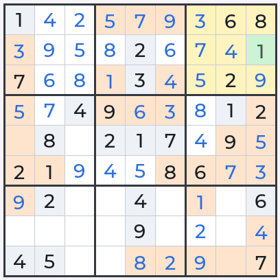

<!-- Written by tools/walkthrough.py extra-regions: edit the script, not this page. -->
# Extra Regions, step 39: the 1 in box 3

**Step 39 of 54** · [← Step 38](step-38.md) · [All steps](../extra-regions.md#the-whole-puzzle-step-by-step) · [Step 40 →](step-40.md)

Box 3 needs a 1, and r2c9 is its last empty cell: **r2c9 = 1**.

**Step 39 of 54** · [← Step 38](step-38.md) · [All steps](../extra-regions.md#the-whole-puzzle-step-by-step) · [Step 40 →](step-40.md)
