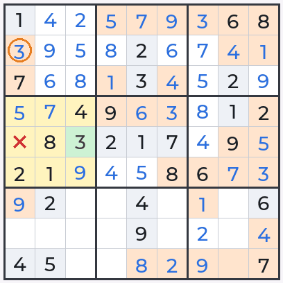

<!-- Written by tools/walkthrough.py extra-regions: edit the script, not this page. -->
# Extra Regions, step 40: the 3 in box 4

**Step 40 of 54** · [← Step 39](step-39.md) · [All steps](../extra-regions.md#the-whole-puzzle-step-by-step) · [Step 41 →](step-41.md)

Box 4 needs a 3. r5c1: column 1 has one (r2c1). Only **r5c3** is left: **r5c3 = 3**.

**Step 40 of 54** · [← Step 39](step-39.md) · [All steps](../extra-regions.md#the-whole-puzzle-step-by-step) · [Step 41 →](step-41.md)
