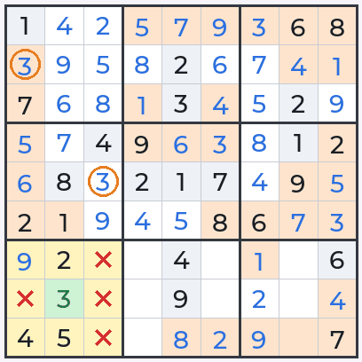

<!-- Written by tools/walkthrough.py extra-regions: edit the script, not this page. -->
# Extra Regions, step 42: the 3 in box 7

**Step 42 of 54** · [← Step 41](step-41.md) · [All steps](../extra-regions.md#the-whole-puzzle-step-by-step) · [Step 43 →](step-43.md)

Box 7 needs a 3. r7c3, r8c3 and r9c3: column 3 has one (r5c3). r8c1: column 1 has one (r2c1). Only **r8c2** is left: **r8c2 = 3**.

**Step 42 of 54** · [← Step 41](step-41.md) · [All steps](../extra-regions.md#the-whole-puzzle-step-by-step) · [Step 43 →](step-43.md)
