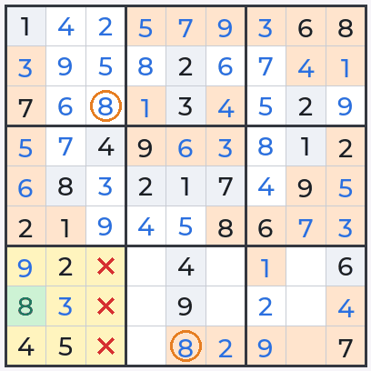

<!-- Written by tools/walkthrough.py extra-regions: edit the script, not this page. -->
# Extra Regions, step 43: the 8 in box 7

**Step 43 of 54** · [← Step 42](step-42.md) · [All steps](../extra-regions.md#the-whole-puzzle-step-by-step) · [Step 44 →](step-44.md)

Box 7 needs an 8. r7c3 and r8c3: column 3 has one (r3c3). r9c3: row 9 has one (r9c5). Only **r8c1** is left: **r8c1 = 8**.

**Step 43 of 54** · [← Step 42](step-42.md) · [All steps](../extra-regions.md#the-whole-puzzle-step-by-step) · [Step 44 →](step-44.md)
