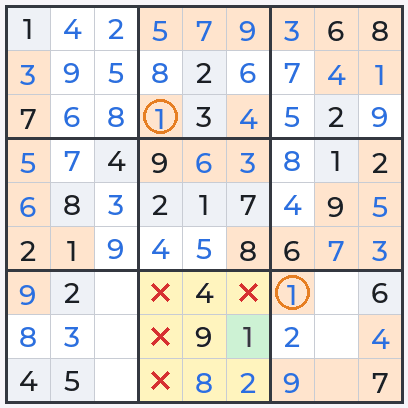

<!-- Written by tools/walkthrough.py extra-regions: edit the script, not this page. -->
# Extra Regions, step 44: the 1 in box 8

**Step 44 of 54** · [← Step 43](step-43.md) · [All steps](../extra-regions.md#the-whole-puzzle-step-by-step) · [Step 45 →](step-45.md)

Box 8 needs a 1. r7c4 and r7c6: row 7 has one (r7c7). r8c4 and r9c4: column 4 has one (r3c4). Only **r8c6** is left: **r8c6 = 1**.

**Step 44 of 54** · [← Step 43](step-43.md) · [All steps](../extra-regions.md#the-whole-puzzle-step-by-step) · [Step 45 →](step-45.md)
