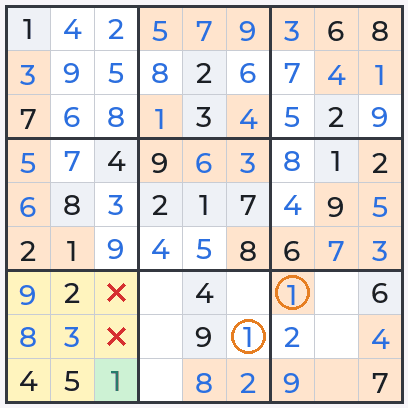

<!-- Written by tools/walkthrough.py extra-regions: edit the script, not this page. -->
# Extra Regions, step 45: the 1 in box 7

**Step 45 of 54** · [← Step 44](step-44.md) · [All steps](../extra-regions.md#the-whole-puzzle-step-by-step) · [Step 46 →](step-46.md)

Box 7 needs a 1. r7c3: row 7 has one (r7c7). r8c3: row 8 has one (r8c6). Only **r9c3** is left: **r9c3 = 1**.

**Step 45 of 54** · [← Step 44](step-44.md) · [All steps](../extra-regions.md#the-whole-puzzle-step-by-step) · [Step 46 →](step-46.md)
