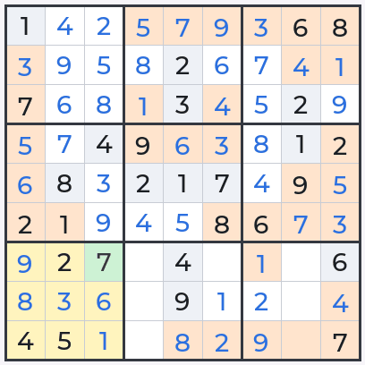

<!-- Written by tools/walkthrough.py extra-regions: edit the script, not this page. -->
# Extra Regions, step 47: the 7 in box 7

**Step 47 of 54** · [← Step 46](step-46.md) · [All steps](../extra-regions.md#the-whole-puzzle-step-by-step) · [Step 48 →](step-48.md)

Box 7 needs a 7, and r7c3 is its last empty cell: **r7c3 = 7**.

**Step 47 of 54** · [← Step 46](step-46.md) · [All steps](../extra-regions.md#the-whole-puzzle-step-by-step) · [Step 48 →](step-48.md)
