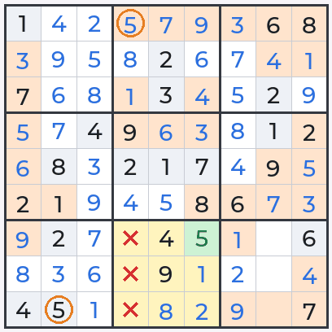

<!-- Written by tools/walkthrough.py extra-regions: edit the script, not this page. -->
# Extra Regions, step 48: the 5 in box 8

**Step 48 of 54** · [← Step 47](step-47.md) · [All steps](../extra-regions.md#the-whole-puzzle-step-by-step) · [Step 49 →](step-49.md)

Box 8 needs a 5. r7c4 and r8c4: column 4 has one (r1c4). r9c4: row 9 has one (r9c2). Only **r7c6** is left: **r7c6 = 5**.

**Step 48 of 54** · [← Step 47](step-47.md) · [All steps](../extra-regions.md#the-whole-puzzle-step-by-step) · [Step 49 →](step-49.md)
