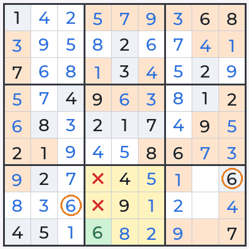

<!-- Written by tools/walkthrough.py extra-regions: edit the script, not this page. -->
# Extra Regions, step 49: the 6 in box 8

**Step 49 of 54** · [← Step 48](step-48.md) · [All steps](../extra-regions.md#the-whole-puzzle-step-by-step) · [Step 50 →](step-50.md)

Box 8 needs a 6. r7c4: row 7 has one (r7c9). r8c4: row 8 has one (r8c3). Only **r9c4** is left: **r9c4 = 6**.

**Step 49 of 54** · [← Step 48](step-48.md) · [All steps](../extra-regions.md#the-whole-puzzle-step-by-step) · [Step 50 →](step-50.md)
