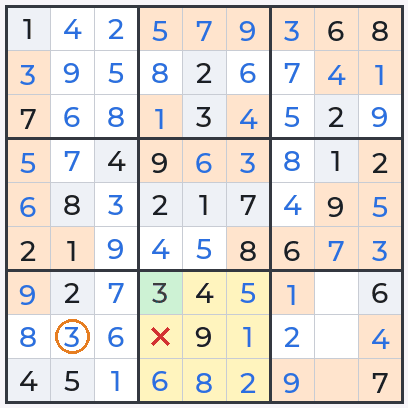

<!-- Written by tools/walkthrough.py extra-regions: edit the script, not this page. -->
# Extra Regions, step 50: the 3 in box 8

**Step 50 of 54** · [← Step 49](step-49.md) · [All steps](../extra-regions.md#the-whole-puzzle-step-by-step) · [Step 51 →](step-51.md)

Box 8 needs a 3. r8c4: row 8 has one (r8c2). Only **r7c4** is left: **r7c4 = 3**.

**Step 50 of 54** · [← Step 49](step-49.md) · [All steps](../extra-regions.md#the-whole-puzzle-step-by-step) · [Step 51 →](step-51.md)
